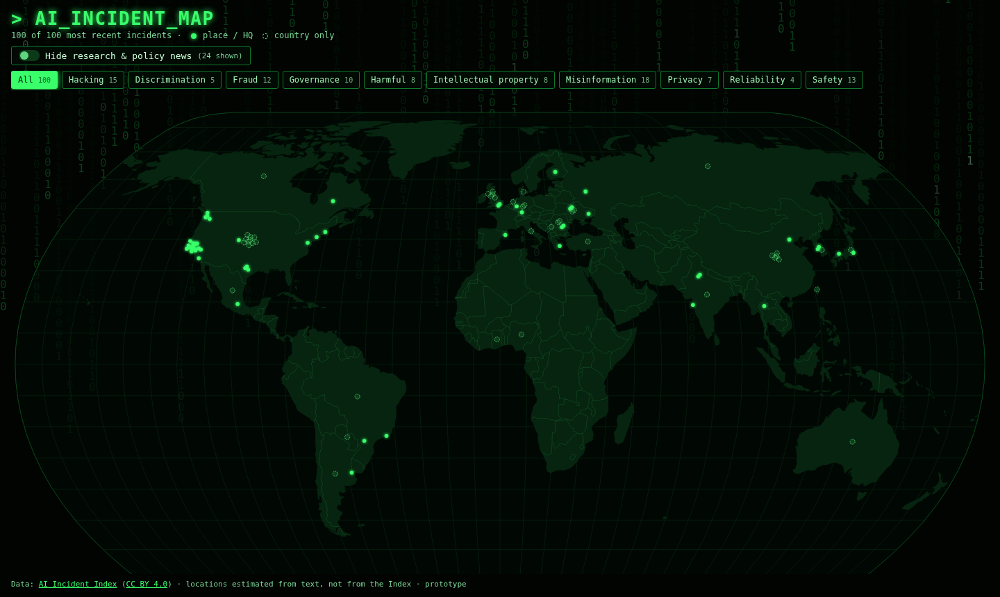

# AI Incident Map

A world map of recent real-world AI incidents (hacks, scams, deepfakes, safety failures and more) in a green "Matrix" style.

**Live:** https://ai-incident-map.pages.dev



## What it does

- Plots the 100 most recent incidents from the [AI Incident Index](https://www.aiincidentindex.com/).
- Filter by category. "Hacking" is the Index's *Security and cyberattacks* category.
- **Hide research & policy news**: switch off studies, warnings, lab tests and policy stories, and keep only things that actually happened. Off by default.
- Click a point for the date, category, evidence status, summary and a link to the original record.
- Solid glowing dots have a specific place or an organisation's HQ. Dashed rings are only placed at the country's centre.

## Data and credit

Data: [AI Incident Index](https://www.aiincidentindex.com/data), licensed [CC BY 4.0](https://creativecommons.org/licenses/by/4.0/). Each point links to its record ID (e.g. `AII-1001-40493`).

The Index has no public download at the moment, so `scripts/scrape.py` reads its public sitemap and incident pages. It stays out of `/api/` (blocked in robots.txt), waits about a second between requests, identifies itself with a clear User-Agent and caches pages in `data/raw/`.

The map positions and the research/event labels are **my estimates**, not the Index's. Records are drafted by an automated system and reviewed by editors. Many are "alleged" or "under investigation", so check the sources before relying on one.

## How locations are estimated

The Index gives a country for each incident, but no coordinates. `scripts/geolocate.py` tries three tiers in order:

| Tier | Method | Share (current 100) |
|---|---|---|
| `place` | spaCy (`en_core_web_sm`) finds place names in the title and summary. Nominatim (OpenStreetMap) geocodes them, restricted to the stated country. Only well-known towns, cities and regions are accepted. | 20% |
| `hq` | Headquarters of the main organisation, from Wikidata, if it is in the same country | 36% |
| `country` | Centre of the stated country | 44% |

Limits:
- The place tier was noisy at first. "AI" matched a hamlet called Ai in Ohio, and "Russia" matched a town in New York. Short all-caps words, nationality words and other countries' names are now ignored, at the cost of fewer precise matches.
- An HQ is where the organisation is based, not where the harm happened. For example, AI lab incidents land in San Francisco.
- A summary can name several places, and the first good match wins.
- Country centres stack up, so overlapping points are spread in a small spiral.

## Research vs real-world events

`scripts/classify.py` is a transparent rule, with the reason stored on each record (`kind_reason`):

> score = research keywords (study, researchers, experiment, simulated, warns, calls for, regulation, policy…) − event keywords (sued, fined, arrested, breach, scam, died, crashed…) + 1 if the Index says *Potential harm*, − 1 if *Actual harm*. The record counts as research/policy if the score is 1 or more and it has at least one research keyword.

The current 100 split into 76 events and 24 research/policy items. A hand check of 15 records agreed on 14. It is meant as a quick filter, not ground truth.

## Running it

```bash
# data pipeline (Python 3.11+)
python -m venv .venv && . .venv/bin/activate
pip install -r requirements.txt
python scripts/refresh.py          # scrape -> geolocate -> classify -> export (N_INCIDENTS=100)

# web app (Node 20+)
cd web && npm install && npm run dev
```

A first run takes a few minutes because of the polite delays. Later runs use the caches.

## Deployment

- Svelte 5 + Vite, D3 for the map (Natural Earth projection, 110m world TopoJSON). No map tiles, so it stays light (about 40 kB of JavaScript, gzipped).
- Every push to `main` deploys to Cloudflare Pages via `.github/workflows/deploy.yml`. It needs the repo secrets `CLOUDFLARE_API_TOKEN` and `CLOUDFLARE_ACCOUNT_ID`.
- `.github/workflows/refresh.yml` reruns the data pipeline. It is **manual only** for now (`workflow_dispatch`). A monthly schedule can be added later.

## Why I built it

A small data project that joins scraping, NLP-based geocoding, rule-based classification and a fast interactive front end. Most of the work is in being honest about uncertainty: precision tiers, evidence status and a transparent classifier, so the map doesn't look more exact than the data is.

## Licence

- Code: [MIT](LICENSE).
- Data: AI Incident Index, CC BY 4.0. The geocoded positions also use © OpenStreetMap contributors (ODbL) via Nominatim, and Wikidata (CC0).
